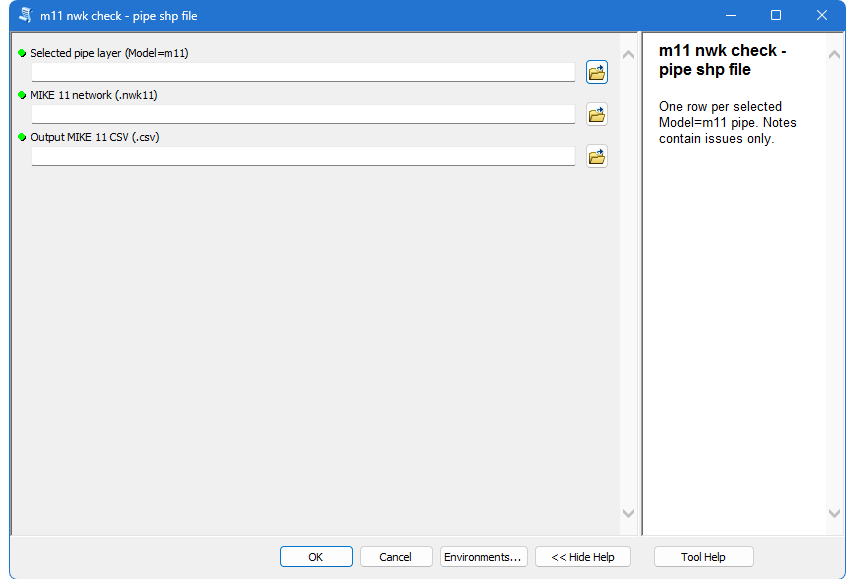
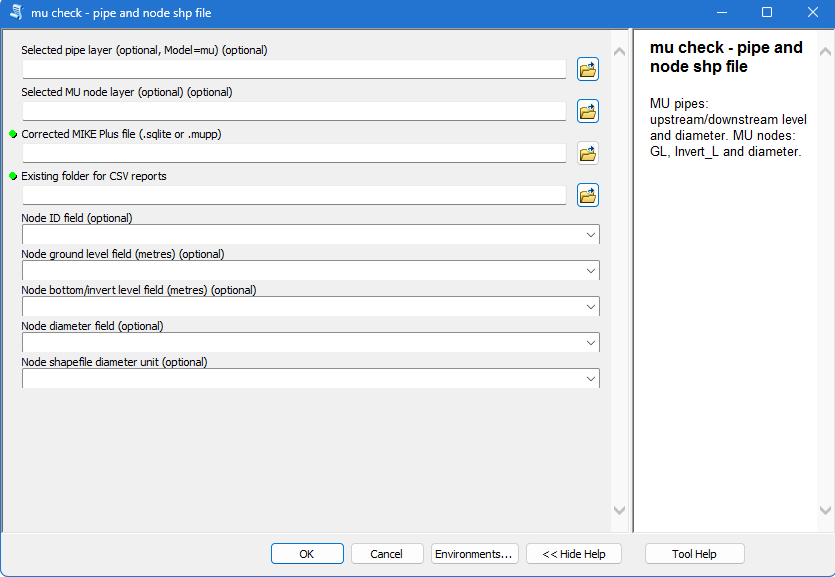
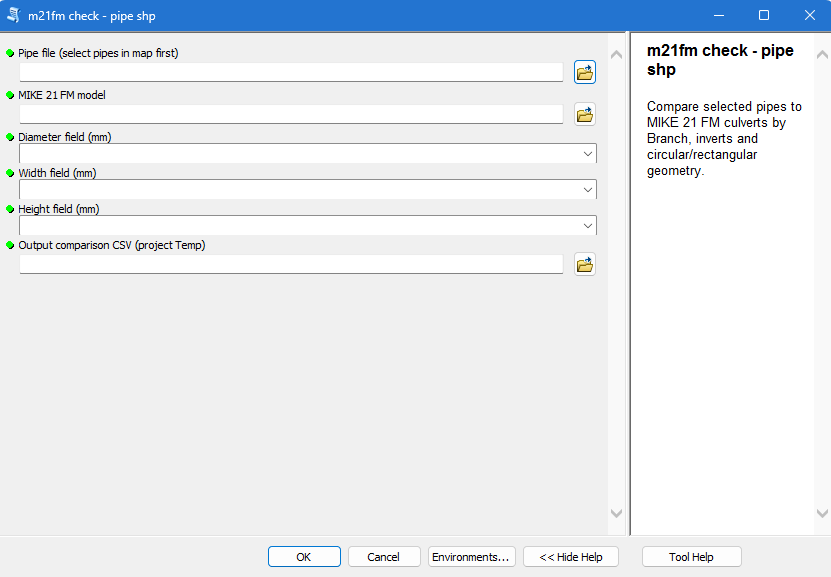
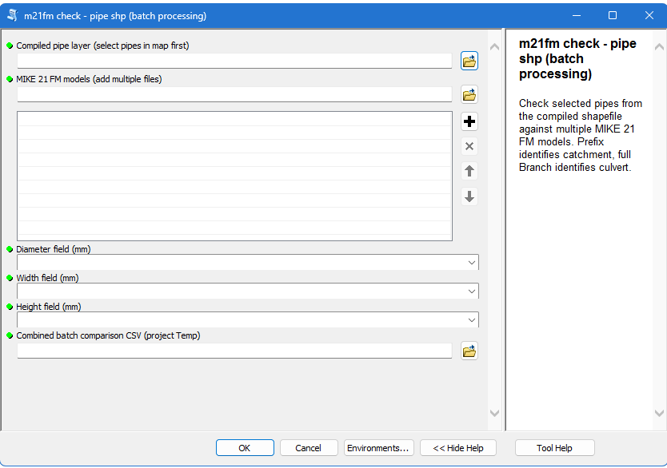

# m11, mu, m21fm crosscheck

An **ArcMap 10.8 toolbox** that checks selected pipe and node shapefiles against **MIKE 11, MIKE+ and MIKE 21 FM** model files.

It shows shapefile values and model values side by side in CSV reports. The reports flag different values, missing values and missing pipe or node IDs. Each saved CSV is added automatically to ArcMap's Table of Contents.

## Four checks in one toolbox

| Check | Shapefile input | Model input | Report |
| --- | --- | --- | --- |
| **m11 nwk check** | Selected pipes with `Model=m11` | `.nwk11` or `.nwk` | One pipe CSV |
| **mu check** | Selected pipes with `Model=mu`, selected nodes, or both | `.sqlite` or `.mupp` | Separate pipe and node CSVs |
| **m21fm check** | Selected M21FM pipes | One `.m21fm` file | One pipe CSV |
| **m21fm check — batch processing** | Selected pipes from a compiled pipe layer | Several `.m21fm` files | One combined pipe CSV |

## Requirements

- ArcMap **10.8**, with its built-in **ArcPy and Python 2.7**.
- Your pipe/node shapefiles and matching model files.
- An existing folder for the CSV reports.

No extra Python packages are needed. This version is built for ArcMap; ArcGIS Pro support has not been verified.

## Install

1. Click **Code → Download ZIP** on this repository.
2. Extract the ZIP into a folder.
3. Keep `m11_mu_m21fm_crosscheck.pyt` and all five `.py` files together.
4. In ArcMap, open the **Catalog** window and browse to that folder.
5. Open **m11_mu_m21fm_crosscheck.pyt**. It appears as **m11, mu, m21fm crosscheck**.
6. Choose one of the four checks.

This replaces the older `M21Checker.pyt` toolbox. If ArcMap still shows the old version, remove its Catalog entry and add the new toolbox.

## Before running a check

1. Add your shapefiles to ArcMap.
2. **Select the features you want to check.**
3. Choose the existing **map layer from the tool's dropdown**. Browsing directly to a `.shp` file does not carry the map selection.
4. Choose the matching model file and an output location.
5. Run the check.

A selection is required. M11 and MU pipe checks then keep only selected pipes whose `Model` value is `m11` or `mu`. For either M21FM check, select the M21FM pipes yourself; these checks do not filter by the `Model` field.

## 1. M11 NWK check

Choose the pipe layer, the MIKE 11 network and the output CSV.

The check matches `Branch` to the culvert ID in the network. It compares inflow, outflow and the supported culvert dimensions. Width, height, length and chainage are checked when their shapefile fields are available.

Common pipe fields:

| Field | Meaning | Unit |
| --- | --- | --- |
| `Branch` | Pipe/culvert ID | Text |
| `Model` | Use `m11` for this check | Text |
| `Z_Inflow` | Inflow level | m |
| `Z_Outflow` | Outflow level | m |
| `Dia_mm` or `diamm` | Diameter | mm |
| `Width_mm`, `Height_mm` | Other culvert dimensions, when available | mm |
| `L_m`, `Lm` or `Length` | Pipe length, when available | m |
| `Chainage` | Culvert position along the model branch, when available | m |

**Length and chainage are checked separately.** A length field is not treated as a chainage field. The model's hydraulic culvert length can differ from a GIS pipe's geometric length. A dimension that does not apply to the model geometry is marked `N/A`.

## 2. MU pipe and node check

Choose a pipe layer, a node layer, or both. Choose the MIKE+ `.sqlite` database or its `.mupp` project file, then choose the CSV output folder.

### Pipes and canals

| Shapefile value | MIKE+ value |
| --- | --- |
| `Branch` | Link ID (`msm_Link.MUID`) |
| `Z_Inflow` | Upstream level (`UpLevel`) |
| `Z_Outflow` | Downstream level (`DwLevel`) |
| `Dia_mm` or `diamm` | Diameter |

Only selected pipes with `Model=mu` are checked.

### Nodes

Use the dropdowns to choose the actual fields in your node shapefile:

| Shapefile value | MIKE+ value |
| --- | --- |
| Node ID | Node ID (`msm_Node.MUID`) |
| `GL` or the chosen ground field | Ground level (`GroundLevel`) |
| `InvertL` or the chosen invert field | Bottom/invert level (`InvertLevel`) |
| `diamm` or the chosen diameter field | Node diameter |

Choose **Millimetres (mm)** or **Metres (m)** for the node diameter field. Levels are in metres.

The outputs are **mu_pipe_check.csv** and **mu_node_check.csv**. If only one layer is supplied, only its report is created.

The checker reads the SQLite database. A `.mupp` file is used to find that database; if its stored database path no longer works, choose `.sqlite` directly. Databases containing scenario alternatives are rejected: first export the intended scenario to a separate database. Empty model levels are flagged as missing rather than replaced with guessed values.

## 3. M21FM pipe check

Choose the selected pipe layer and one `.m21fm` model. Choose the diameter, width and height fields in the dialog. These shapefile dimensions must be in **millimetres**.

The check matches `Branch` to the model culvert and compares:

- Inflow and outflow levels.
- Diameter for circular culverts.
- Width and height for rectangular culverts.

Dimensions that do not apply are marked `N/A`. Geometry that the parser cannot read is flagged for review.

## 4. M21FM batch check

Choose the selected compiled pipe layer and add all required `.m21fm` models. Choose the diameter, width and height fields and a combined output CSV.

The first two letters of a Branch and model filename identify the catchment. For example, a Branch beginning `BG_` is expected in a model file beginning `BG_`. The full Branch identifies the culvert.

The report flags missing branches, missing catchment models, duplicate branches and branches found in the wrong catchment. Numeric values are compared only when a Branch has one clear match in the correct catchment.

## Units and CSV reports

Pipe diameter, width and height are converted from **mm to m** before comparison with model dimensions. For example, **400 mm = 0.4 m**. The numeric comparison tolerance is **0.001 m**.

Each report contains one row per checked feature, with model values, shapefile values and comparison results. Missing model IDs still get a report row. M11 and MU also include `Result` and `Notes`; matching rows have empty Notes.

| Result or check | Meaning |
| --- | --- |
| `MATCH` | Values agree within the tolerance |
| `MISMATCH` | Values differ beyond the tolerance |
| `MISSING_…` | An ID or required value is missing; the exact status identifies it |
| `N/A` | The dimension does not apply to this geometry |
| Other geometry or batch status | Read the flagged geometry/matching status before using the values |

Extra model-only IDs are not added as extra CSV rows. M11 and MU warn about model IDs absent from the full source shapefile in the geoprocessing messages.

### Output location

All four tools look above the source shapefile for a numbered project folder such as `002_SFRM_Berngau` and use its **existing Temp folder**. If no suitable folder is found, choose an output location manually. A missing Temp folder is not created automatically.

| Check | Default CSV filename |
| --- | --- |
| M11 | `<pipe-file>_m11_check.csv` |
| MU pipes | `mu_pipe_check.csv` |
| MU nodes | `mu_node_check.csv` |
| M21FM | `<pipe-file>_comparison.csv` |
| M21FM batch | `<pipe-file>_batch_comparison.csv` |

An existing CSV at the chosen path is overwritten. Use another name or folder to keep earlier reports.

### Tables in ArcMap

Saved CSVs are added automatically to the active data frame. Use **List By Source** in the Table of Contents to see the standalone tables. Rerunning a report refreshes its existing table entry. Run the tools in the foreground inside ArcMap for this feature. If a CSV cannot be added, the tool gives a warning and keeps the saved report.

## Files

| File | Purpose |
| --- | --- |
| `m11_mu_m21fm_crosscheck.pyt` | Toolbox and four dialogs |
| `m11_nwk_check.py` | M11 comparison |
| `mu_check.py` | MU pipe and node comparisons |
| `m21fm_check.py` | Single-model M21FM comparison |
| `m21fm_batch_check.py` | Batch M21FM comparison |
| `crosscheck_common.py` | Shared CSV, field, output-folder and ArcMap helpers |
| `docs/screenshots/` | The four tool screenshots |
| `README.md` | Installation and use |

ArcMap can create `.pyc` and `.pyt.xml` files locally. They do not need to be downloaded separately. Project model files, shapefiles and generated reports are not included in this repository.

## Validation and limits

The combined scripts produced the same CSV contents as the supplied working scripts on the sample data: 25 M11 pipes, 58 MU pipes, 65 MU nodes, 131 M21FM pipes and 131 M21FM batch rows. Dialog setup, output paths, unit conversion and table-addition logic were also checked with an ArcPy substitute. These are code checks; actual execution in Windows ArcMap was not tested in this development environment.

The parsers follow the supplied model formats. Other exports or database schemas may need changes. This toolbox compares attributes; it does not change model files or shapefile values.

## Licence

No open-source licence has been added to this repository.
